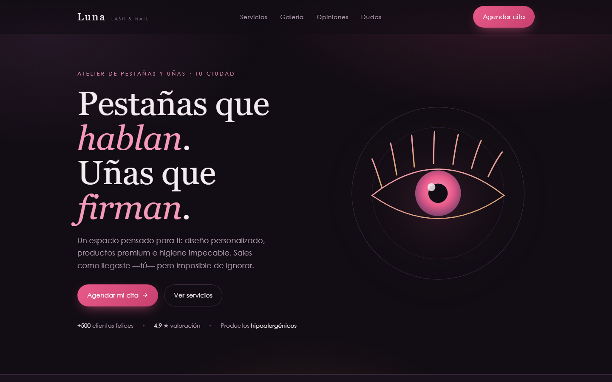

# Landing para un salón de pestañas y uñas



> Proyecto hecho para un cliente. El nombre del negocio es ficticio.

Sitio de una sola página para un **salón de pestañas y uñas** con estética editorial oscura, pensado para
convertir visitas en **citas por WhatsApp**.

**Características**
- **Un solo archivo HTML**, sin dependencias ni build: CSS y JavaScript en línea e ilustraciones **SVG** hechas
  a mano, sin imágenes externas.
- **Agendado por WhatsApp**: el formulario arma el mensaje con el servicio, la fecha y el nombre, y abre
  `wa.me`. Recuerda los datos del cliente con `localStorage`.
- Secciones de servicios con precios, galería, opiniones y preguntas frecuentes.
- **Responsive** (el hero de dos columnas se apila en el móvil), tipografía fluida con `clamp()` y respeta
  `prefers-reduced-motion`.
- Toda la configuración (WhatsApp, Instagram, TikTok, nombre) está en un objeto `CONFIG` al final del archivo.

## Uso

Abre `index.html` en el navegador o súbelo a cualquier hosting estático. Para personalizarlo, edita `CONFIG`:

```js
whatsapp: "5215512345678",   // código de país + número
instagram: "https://instagram.com/tu-cuenta",
```

**Tecnologías:** HTML5 · CSS (custom properties, grid, clamp) · JavaScript vanilla · SVG
